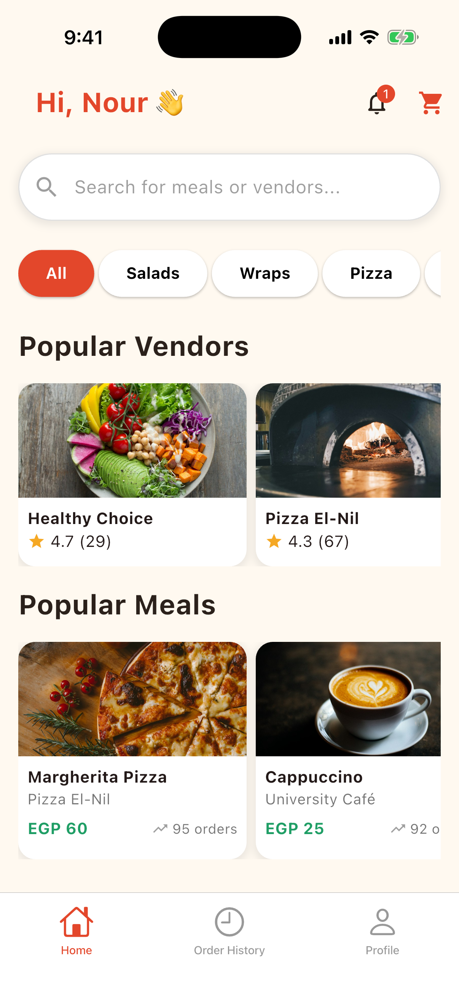
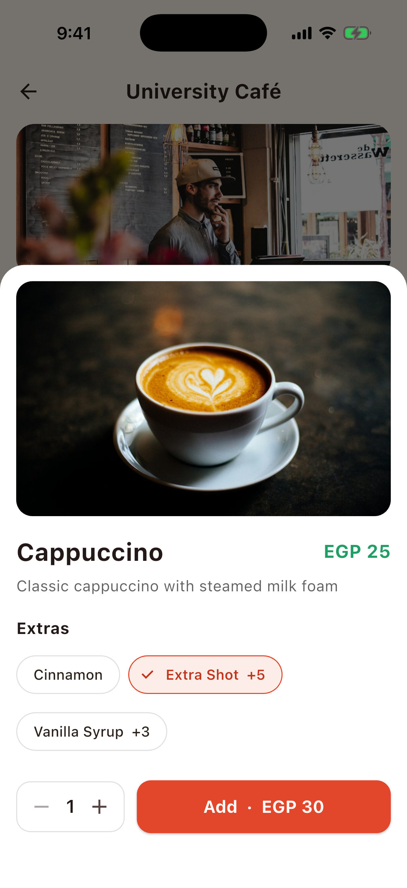
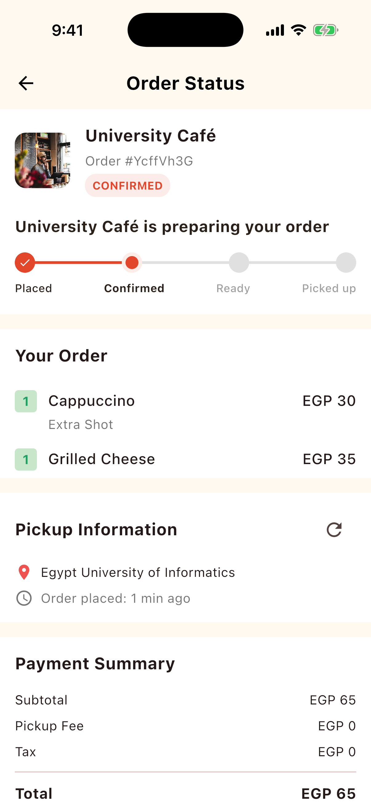
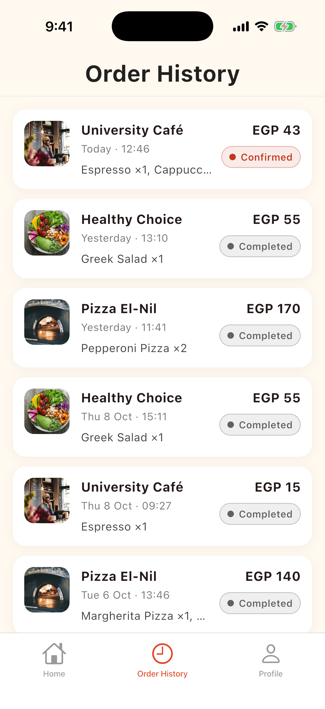
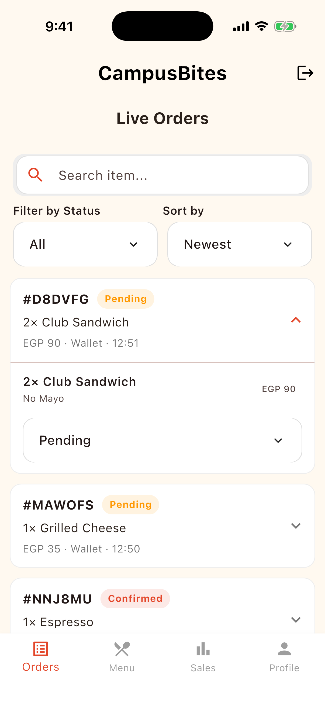
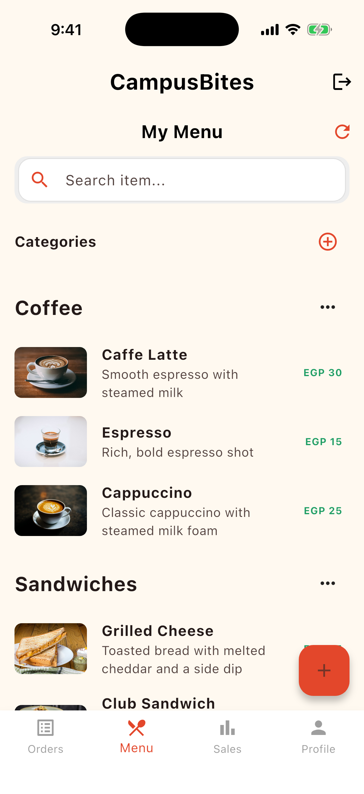
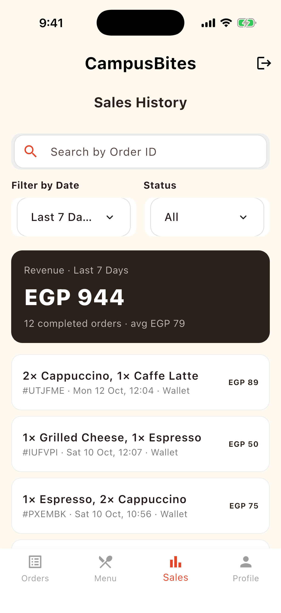
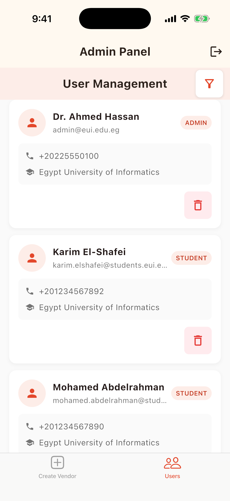

# CampusBites

Campus food ordering for Egyptian universities, as three Flutter apps on Firebase: students order and pay from campus vendors, vendors run a live order queue, and university admins manage accounts.

   

   

All screenshots are from the demo build: the real apps running against the Firebase emulators with seeded data. To run it yourself, see [tool/demo](tool/demo/README.md).

---

This is a **Flutter monorepo** containing three separate apps for different user roles:

- 👤 `admin_app`
- 🛒 `vendor_app`
- 🧑‍💼 `customer_app`

It also includes reusable shared packages to keep your code DRY and maintainable.


## 🗂️ Project Structure

```

campusbites/
├── apps/
│   ├── admin_app/       # Flutter app for Admins
│   ├── vendor_app/      # Flutter app for Vendors
│   └── customer_app/    # Flutter app for Customers
│
├── packages/
│   ├── core/            # Shared business logic (models, services)
│   ├── ui/              # Shared UI widgets and themes
│   └── utils/           # Shared utilities and extensions
│
├── melos.yaml           # Melos workspace config
├── pubspec.yaml         # Optional root-level file
├── .gitignore
└── README.md

````


## 🛠 Getting Started

### 1. Install Melos (if not already)

```bash
dart pub global activate melos
```

> Make sure `$HOME/.pub-cache/bin` is in your `PATH`.
> Add this to `~/.zshrc` or `~/.bashrc` if needed:

```bash
export PATH="$PATH":"$HOME/.pub-cache/bin"
```

---

### 2. Bootstrap the Workspace

```bash
melos bootstrap
```

This links all internal packages and installs dependencies across apps and packages.

---

## 🚀 Running an App

Choose the app you'd like to run:

```bash
# Admin App
cd apps/admin_app
flutter run

# Vendor App
cd apps/vendor_app
flutter run

# Customer App
cd apps/customer_app
flutter run
```

---

## 📦 Working with Shared Packages

Shared packages (like `core`, `ui`, `utils`) are located under `packages/`.

To use one in an app, add this to the app's `pubspec.yaml`:

```yaml
dependencies:
  core:
      path: ../../packages/core

```

Then import it in Dart:

      import 'package:core/core.dart';

Make changes in the shared packages just like you would in any Flutter package. Use `melos bootstrap` again if you add new packages or dependencies.


## ✅ Scripts & Tips

### Clean everything

      melos clean
      flutter clean

### Re-bootstrap after dependency changes

      
      melos bootstrap
